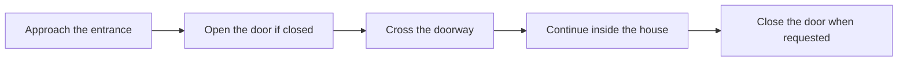

# Interactive objects after the Rapier trial

**Status: stage 1 implemented and deployed on 9 November 2026 after a separate explicit deployment request.** See [results and evidence](README.md) and [deployment record](deployment/deployment.json). Stages 2–4 remain future proposals.

This phase builds on the [Rapier trial results](../rapier-trial/README.md) and [ownership/replay design](../rapier-trial/ARCHITECTURE.md). The original [trial checkpoint](../rapier-trial/CHECKPOINT.md) records its separate completion. The 9 November instruction authorizes stage 1 implementation; further objects and paid services remain separate. Deployment was subsequently authorized and completed.

## Outcome and priority

The first deliverable is faithful execution of: **“Bear goes to the house, opens the door and comes in.”** Bear must visibly enter and continue inside, rather than merely reaching the house and disappearing.

User clarification: the door only needs to **open and close** in the first approximation. Detailed hinges, handles, mechanical construction and simulated hinge joints are unnecessary. A single movable panel with a simple authored animation is sufficient if the action reads clearly.

Preserve the agreed quality order: staging and spatial relationships first; recognizable shapes second; textures later. Keep the existing Three.js renderer, animation workflow and story editor.

## First milestone: Bear and the house door

### Minimum object contract

| Element | Minimum needed |
|---|---|
| House entrance | Stable identity, an exterior approach position, a doorway crossing and a linked interior arrival position |
| Door | Stable identity, a visibly movable panel, open/closed state and a timed transition between them |
| Bear | An authored approach, readable opening action, unobstructed crossing and continuation inside |
| Story compiler | Explicit opening, closing and entering actions with prerequisites; entering the house must be distinguished from leaving the story |
| Playback | Object state and movement derived consistently from story time, including seeks, replay and edits |

The logical door can be addressable even if its frame remains part of a combined house mesh. A small scene-node adjustment or replacement panel may be needed; detailed decomposition of the whole house is not a prerequisite.

### Implementation sequence, once authorized

1. Inspect the current house geometry, door representation, entrance marks, director vocabulary, compiler transitions and interior staging. Reconcile the completed Rapier trial and preserve existing interaction work.
2. Establish the exterior/interior connection and camera staging before adding visual detail. Use a readable crossing of the doorway. A motivated camera cut at the threshold is acceptable if the next shot shows Bear continuing inside and preserves his identity, carried items and story state.
3. Add only the minimal door identity and state needed for `open`, `close` and `enter`. Normalize English/Russian instructions into those actions; avoid mapping house entry to an offstage disappearance.
4. Author a simple opening/closing motion. The door panel follows the animation timeline; Bear follows the existing locomotion/animation system. Detailed hand-to-handle contact is a later refinement, not a first-release dependency.
5. Enforce prerequisites: an already-open door need not reopen; Bear crosses only when the opening is clear; closing occurs when requested. A closed-door obstacle must agree with the visible panel if collision participates.
6. Make ownership and replay explicit. Opening progress and logical state come from timestamped story actions. If Rapier is useful for this doorway later, animation drives the door collider; physics must not fight the authored panel transform. Do not require a full Bear physics controller or a mechanical hinge simulation for this milestone.
7. Test the complete story in the real editor, run adversarial review → update, and show actual before/after recordings before proposing broader object coverage.

### Acceptance checks

- The exact English instruction and its Russian equivalent produce a readable approach → opening → crossing → interior continuation.
- Bear remains a participant inside and can perform a subsequent action there. The door transition is visible; a fade alone does not stand in for entering.
- Explicit open and close instructions work. An already-open entrance and repeated open/close requests behave sensibly.
- Bear does not visibly walk through a closed panel or solid doorway edge. Camera framing makes the opening and crossing understandable.
- Door state persists across story scenes. Seeking to before, during and after opening/closing reconstructs the correct state; replay is repeatable.
- Pausing holds both actor and door. Resuming continues from the same point. Editing or deleting the relevant scene invalidates obsolete door state and movement.
- Existing interior seating, cooking, hugs and shoulder rides still behave as before. Include an actual carried-prop entry if that is already supported; do not expand into new carrying mechanics.
- Report visible limitations honestly. No implication that every house part or every object is interactive after this milestone.

## Expansion after the door case is accepted

Prioritize objects by the stories they enable. Addressability means an object has a stable identity, meaningful state and supported actions; it does not require every mesh fragment to become an independent entity.

| Stage | Candidate scope | Meaningful state/actions | Gate before expansion |
|---|---|---|---|
| 1 | House door and connected entrance | Open, close, enter, exit | Door story and replay checks above pass |
| 2 | One container, such as a cupboard | Open, close; then reveal/retrieve one contained item | Container state, contents and item ownership agree visibly |
| 3 | Individual carrots in one garden bed | Planted, picked, held, placed; stable identity per carrot | Picking one carrot changes that carrot only; no duplicates or unexplained replacement |
| 4 | Additional useful furniture and tools | Small, explicitly supported action sets per object | Each addition enables a tested story and preserves existing interactions |

Stages 2–4 are proposals for prioritization, not an instruction to implement them together. Background decoration can remain grouped until a story needs to act on it.

## Design boundaries

- Build the minimum reusable object/action contract demonstrated by the door, then extend it from working examples. Avoid a speculative universal simulation or an exhaustive parts catalog.
- Keep semantic identity separate from rendering meshes and collision shapes. One logical object may use several meshes or one simple collider.
- Define ownership at every transition: resting in the world, attached to a character, undergoing authored movement, or released to physics. Each transform has one controller at a time.
- Let the Rapier trial inform collision and replay choices; its completion does not imply that physics is ready for every object, character or location.
- No ragdolls, cloth, detailed hinge mechanics, full-house remodelling, texture pass, all-object conversion, or rewrites of existing paired interactions in the first milestone.

## Deliverables for the future implementation

1. A working door-entry story in the existing game, with open/close behavior and interior continuation.
2. A short object/action/ownership contract grounded in that implementation.
3. Behavioral regression evidence and actual before/after recordings, including timeline controls and an edited scene.
4. Adversarial findings, applied fixes, remaining limitations, and a recommendation for the next object family.

**Next action after stage 1 review: choose the next object family.** Deployment remains a separate user-requested step.
