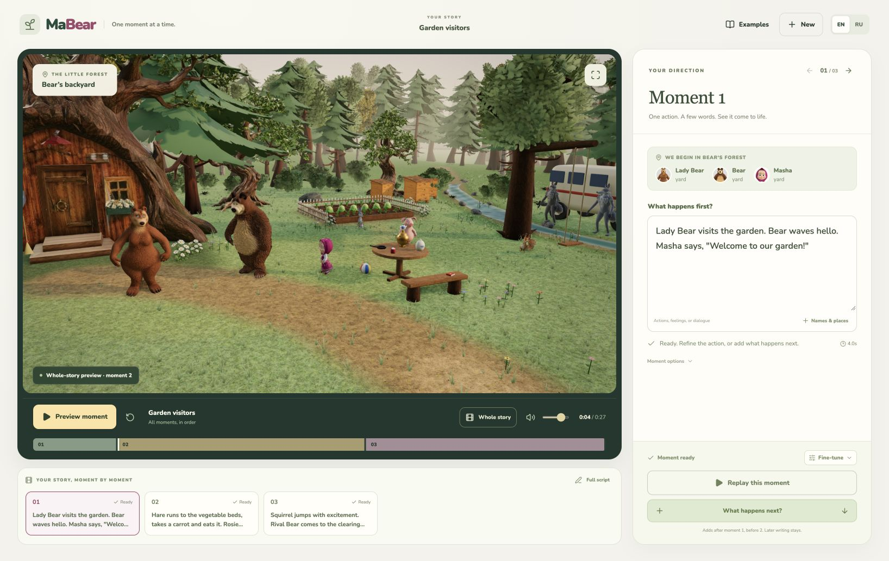
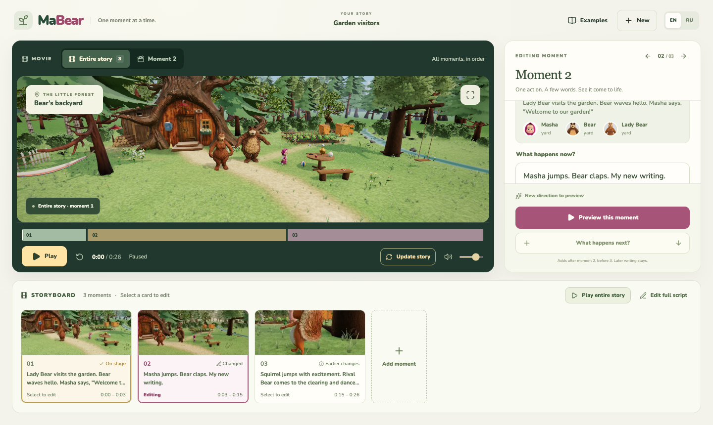

# Movie transport and storyboard

The original bug was behavioral: Pause destroyed the movie request; the next primary action restarted the selected moment, even while the monitor still said whole story. Editing a different card also moved the movie playhead.

| Flow step | Captured evidence | Finding / resulting behavior |
|---|---|---|
| 1. Open an empty studio | [Before](01-before-empty.png) | Whole story competed with the small secondary controls. Entire story is now the default, visible above the movie. |
| 2. Load a complete example | [Before](02-before-story.png) | The script sequence was a small text strip under one column. A full-width storyboard now contains actual compiled film stills, order, timing, and writing state. |
| 3. Pause whole-story playback | [Before](03-before-paused-story.png) | At 0:04, the primary action changed to “Preview moment.” Play now keeps the paused scope and timestamp; Replay and Update are explicit. |
| 4. Select/edit while reviewing | [After desktop](04-after-desktop.png) | Editor selection changes independently during entire-story playback. Selected-moment preview remains bounded and retains earlier context. |
| 5. Edit on a narrow screen | [After mobile](05-after-mobile.png) | Movie, storyboard, then inspector. The persistent player includes scope, time, Play/Pause, replay, and sound. |

## Reference decisions

| Primary reference | Relevant documented behavior | Applied decision |
|---|---|---|
| [Adobe Premiere: active sequence in Program Monitor](https://helpx.adobe.com/sg/premiere/desktop/render-and-export/render-sequences-for-playback/play-active-sequence-in-program-monitor.html) | Program Monitor previews the assembled sequence; Play begins at the current playhead. | Persistent movie scope and ordinary Play/Pause, independent of the selected editor card. |
| [Toon Boom Storyboard Pro 25: interface](https://docs.toonboom.com/help/storyboard-pro-25/storyboard/interface/about-interface.html) | Stage, chronological thumbnails, panel editing, and playback have distinct roles. | Movie monitor, direction inspector, and storyboard are separate visible areas. |
| [Toon Boom Storyboard Pro 25: Play menu](https://docs.toonboom.com/help/storyboard-pro-25/storyboard/reference/menus/main/play-menu.html) | Full animatic playback and selected-panel playback are explicit separate actions. | Entire story / Moment scope is explicit; updating selected direction lives in its inspector. |

Copying a professional editor's dense toolbars would add friction here. The useful pattern is separation of movie playback, ordered story structure, and editing selection.

## Verification and limits

- Focused unit coverage: real Player time freezes/resumes; moment endpoint excludes the next scene; scope and editor selection remain independent; scrubbing and replay are distinct; paused preparation never autoplays; resume makes no new director requests.
- Audio pause preserves the active session: native speech pause/resume, suspended WebAudio time, and frozen pending speech timers. Seek, replay, or replacing compiled work discards that session. [Speech pause API](https://developer.mozilla.org/en-US/docs/Web/API/SpeechSynthesis/pause), [WebAudio suspend API](https://developer.mozilla.org/en-US/docs/Web/API/AudioContext/suspend).
- Browser coverage includes writing preservation, insertion, continuity, failure, full script, fullscreen, English/Russian, narrow layout, and the actual transport playhead. The test samples the playhead in the click event; delayed automation reads include renderer time.
- Film stills are derived from compiled frames, never generated substitutes. Cached unchanged timelines avoid recapturing stills on every pause.
- Screenshots verify hierarchy and visible states. They do not establish complete accessibility compliance or the sound of installed native voices. Tests prove speech is retained rather than canceled/requeued; word-perfect native speech behavior remains platform-dependent and needs listening.

## Final checks

- 51 focused unit tests passed across playback, real Player, story flow, and audio scheduling.
- Four existing moment-studio browser flows passed. The new transport browser regression passed on its focused rerun after replacing a renderer-dependent delayed timestamp read with synchronous click-event sampling.
- Both final screenshots were opened and inspected. Desktop is 1440×860; mobile is 390px wide, with no horizontal document overflow.
- Final integration adds location-aware monitor labels (yard, house, pond, wolves), explicit cast-inspection visibility that resets on Play, and the existing voice panel's separate audition link.
- Independent review identified the audition's paused-speech cancellation problem; the audition owner corrected cancellation/resumption and verified it separately.
