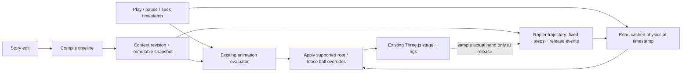

# Bounded Rapier trial

Historical trial architecture. The 9 November follow-up enables supported physics by default in the local main app, adds conservative guards/background preparation, and implements the house door: [current integration](../interactive-objects/README.md). That follow-up has not been deployed by its implementation task.

Three.js and the existing motion/rig/contact code remain the renderer and animation system. `?physics=rapier` explicitly enables the experiment in the local or deployed editor. The normal player never imports the Rapier bundle. `/physics/` is a separate silent demo using the reviewed fixtures, with no store, audio engine or generation calls. Dependency: exact `@dimforge/rapier3d-compat` 0.21.0.

| Object/state | Owner | Contract |
|---|---|---|
| Masha in uncomplicated standing yard stories | Animation requests displacement; Rapier capsule constrains root | Use authored displacement increments, so a blocked actor does not accelerate to catch up. Sliding enabled; furniture autostep disabled. Reduce existing gait amplitude when blocked. |
| Masha in stories containing pickup, paired contact, sitting, rides, scene cuts or unsupported travel | Animation throughout that timeline | Conservative bypass prevents snapping a displaced actor back into a hug/ride. No rewrite of contact choreography. |
| Masha bones, expression, yaw, camera, light, other characters/props | Existing animation | No ragdolls, new character controller input, or camera rewrite. |
| Held ball | Animation + loaded hand socket | Sample the actual rig/socket transform at the release cue, independent of the last rendered frame. |
| Explicit `masha drop ball`, after 50% of clip | Rapier sphere | Gravity, restitution, friction, damping and sleep. Render quaternion and base-origin correction bypass semantic mark snapping. No throw impulse. |
| Ball taken/hidden later | Animation | Authored reattachment/hiding ends physics. Later pickup is not retargeted to its simulated resting point; that is a known integration boundary. |

## Timestamp integration

`Player` accepts an optional `PlaybackEvaluator`. The ordinary pure `evaluate` is unchanged except the additive drop cue. The replay layer steps at 1/60 s, splitting a step exactly at an authored drop. It stores compact root/ball transforms, ground/stride state and a frontier Rapier world. Queries behind that frontier interpolate cached transforms; they never reverse a world or depend on wall-clock/frame pacing. A forward seek computes the missing prefix once. No per-frame renderer feedback enters physics.

A snapshot of the timeline is invalidated by serialized content in `setTimeline`, including in-place edits. All preview wrappers share the single canonical trajectory and full-story ownership decision. Their physical query time clamps at the preview endpoint, without changing simulation steps. At a scene-boundary ownership handoff, the previous moment can read the stored left-hand state. Disposal or edits free the WASM world. The bounded trial declines root physics and drops for stories over 180 seconds. That guard and choreography bypass are exposed by `inspect().reason`.

Physics clamps to the selected preview endpoint, including non-grid times, and holds there. The existing final idle fidgets may continue; they do not run the physics clock. Replay and resuming use the same timestamp trajectory. Full-story playback and a partial-moment preview share the same prefix dynamics; a completed moment cannot accidentally evaluate the next scene.

## Geometry and boundaries

Simple capsule for Masha (1 m tall, 0.22 m radius, 0.01 m skin), 0.15 m sphere for the ball. Covered region is the central yard rectangle x ∈ [−3,5], z ∈ [−1,6]. Flat yard floor, round table top/pedestal/cross feet, bench seat/log legs and the two helper treads. Nominal dimensions match the procedural furniture. Mesh ornament, other trees/buildings/locations, actor-to-actor and ball-to-actor collisions are excluded. Spawn overlap declines root physics instead of silently teleporting the actor. Physics supplies world support height; stage does not add its scripted support lift a second time. No automatic furniture climbing.

## Baseline and reproducibility

`baseline-source.tar.gz` and `baseline-manifest.json` capture the exact pre-trial source, public assets and lockfile; `baseline-status.txt` records pre-existing work. Baseline tests: 770 passed across 63 files. Existing-story recordings use that snapshot. The new drop cue has an explicitly labelled animation-only control; it did not exist in the old release. Neither side calls director/TTS services. The subsequent user-authorized opt-in deployment is recorded separately in `deployment/deployment.json`; original capture fingerprints are preserved.

## References and limits

[Rapier character controller](https://rapier.rs/docs/user_guides/javascript/character_controller/) describes collision-adjusted movement, explicit gravity and snap-to-ground. [Determinism](https://rapier.rs/docs/user_guides/javascript/determinism/) requires identical initial values, insertion order and step sequence. The existing animation uses trigonometry; this trial verifies reproducibility on the tested browser/device, not bit identity across every browser. [Compatibility initialization](https://rapier.rs/docs/user_guides/javascript/getting_started_js/) documents the embedded WASM package.

## Data flow

The dotted release sample applies the known authored pose directly to the loaded rig, without GPU rendering. It does not read the last display frame. Assets must be ready before creating the replay adapter.

## Review corrections

The first implementation keyed separate worlds by preview wrappers. Independent review showed that this could change ownership and alter non-grid endpoint integration. The final implementation uses one canonical trajectory for every preview and stores the left side of an ownership boundary when necessary. Trial eligibility is limited to covered central-yard geometry; bridges and porch support remain scripted.

The first drop staging hit the bench edge and sent the ball through Masha's skirt because actor/ball collision is excluded. The accepted gesture extends the ball sideways above the bench before release. It falls onto the bench top and settles there; it no longer claims an edge bounce or rolling behavior. Rejected visual evidence is retained under `iteration-1/`.
