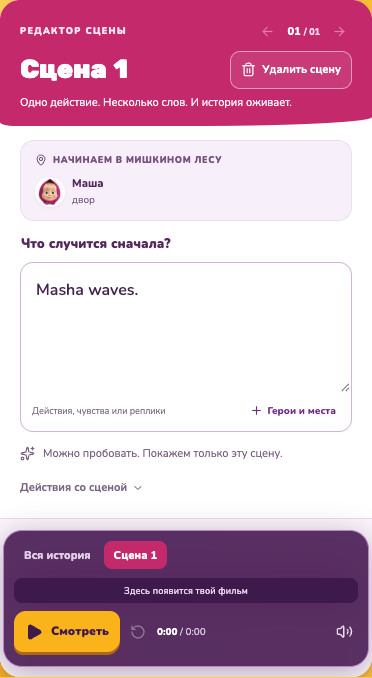

# Visible scene deletion

Delete was buried in the collapsed Scene options section inside the scrolling editor. The original menu-path browser test also hit footer pointer interception. The removal action now lives beside the scene title, outside that scrolling area, with a trash icon and explicit EN/RU text. Its existing confirmation remains; deleting the only scene explains that an empty scene will remain for new writing.

Validation: typecheck/build pass; `tests/e2e/sceneDeletion.spec.ts` passes at desktop and mobile sizes, covering visibility, cancellation, deletion, Russian labels, last-scene reset, and persistence after reload. This authoring test intentionally blocks GLB loading to confirm deletion does not require the renderer to be ready. The original broader menu-path test did not pass; other Scene options were not changed in this fix.

Deployed version: `443d65e0-89eb-43ff-830b-c416b574ee88` at https://mabear-storybook.ilya-baimetov.workers.dev. Signed-in live verification opened the new Delete confirmation and canceled it; the user's existing story remained intact.

